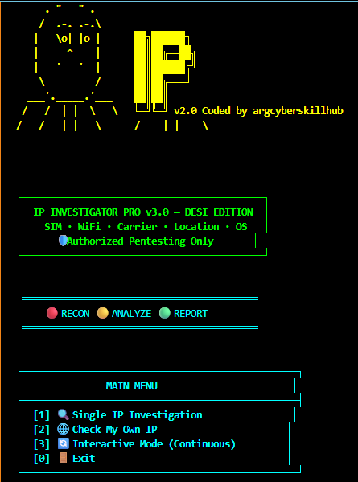

# 🛡️ IP INVESTIGATOR PRO v3.0 — FINAL BEAST MODE

<p align="center">
  
  
  
  
  
</p>

<p align="center">
  <b>Developed by ARG Cyber Skill Hub</b>
  <br>
  <i>Learn Today • Secure Tomorrow</i>
</p>

---

## 🔍 About the Project

**IP INVESTIGATOR PRO v3.0 — FINAL BEAST MODE** is a Python-based IP intelligence and network investigation utility designed for cybersecurity learners, ethical hackers, security researchers, and authorized penetration testers.

The project aims to organize publicly available IP intelligence and network-related information into a convenient investigation workflow.

Depending on the implemented modules and available API access, it may support IP information lookup, approximate geolocation, network/provider information, operating-system clues, and port-related investigation.

> ⚠️ Actual results depend on the Python implementation, API availability, permissions, and network conditions. This tool does not guarantee exact physical location, Wi-Fi credentials, or identification of a device owner.

---

## 🚀 Features

- 🌐 **IP Intelligence:** Investigate public IPv4 and IPv6 addresses.
- 📍 **Approximate Geolocation:** Retrieve available location information from supported IP intelligence services.
- 📡 **ISP & Network Information:** Inspect available network provider and ASN information.
- 🖥️ **OS Intelligence:** Examine operating-system indicators when supported data is available.
- 🔌 **Port Investigation:** Review port-related information through implemented and authorized methods.
- 📶 **Network Research:** Organize available network intelligence for security analysis.
- 🔎 **API Integration:** Optional integration with IPinfo and Shodan, subject to implementation and API access.
- ⚡ **Command-Line Interface:** Run investigations directly from a terminal.
- 🐍 **Python-Based:** Easy to inspect, maintain, and extend.
- 🔐 **Security-Focused:** Intended for authorized investigations and educational labs.

**Note:** Features listed above describe the intended project scope. Only features implemented in `ip_investigator_v3.py` will actually run.

---

## 📸 Project Screenshots

<p align="center">
  <b>IP INVESTIGATOR PRO — Preview Gallery</b>
</p>

<!-- SCREENSHOT 1: MAIN INTERFACE -->

<p align="center">
  
</p>


```


**Important:** GitHub sanitizes some HTML and may not honor every CSS or sizing attribute identically. For responsive screenshots, use a supported percentage width and test the result on GitHub.

Save your actual screenshots inside the `screenshots/` directory using the exact filenames referenced above.

```

## 🛠️ Requirements

- Python 3.10 or newer recommended
- Internet connection for online lookups
- `requests` Python package
- Optional IPinfo credentials
- Optional Shodan credentials

API availability, account limits, and provider terms apply.

---

## ⚙️ Installation

### 1. Clone the Repository

Replace the repository URL if your project is hosted elsewhere.

```bash
git clone https://github.com/argcyberskillhub/IP-INVESTIGATOR-PRO.git
cd IP-INVESTIGATOR-PRO
```

### 2. Create a Virtual Environment

**Windows PowerShell**

```powershell
python -m venv .venv
.\.venv\Scripts\Activate.ps1
```

**Linux / Kali Linux**

```bash
python3 -m venv .venv
source .venv/bin/activate
```

### 3. Install Dependencies

```bash
python -m pip install --upgrade pip
python -m pip install -r requirements.txt
```

### 4. Configure API Credentials

Create a local `.env` file or configure environment variables.

Example `.env.example`:

```dotenv
IPINFO_TOKEN=your_ipinfo_token_here
SHODAN_API_KEY=your_shodan_api_key_here
```

Do not commit real credentials to GitHub.

**Important:** A `.env` file is not automatically read by Python unless the script loads it or the required environment variables are configured. The current script must use `os.getenv()` or an appropriate configuration loader to read these values.

For Windows PowerShell:

```powershell
$env:IPINFO_TOKEN = "YOUR_IPINFO_TOKEN"
$env:SHODAN_API_KEY = "YOUR_SHODAN_API_KEY"
```

For Linux / Kali Linux:

```bash
export IPINFO_TOKEN="YOUR_IPINFO_TOKEN"
export SHODAN_API_KEY="YOUR_SHODAN_API_KEY"
```

If a real API key has already been exposed, revoke or rotate it with its provider.

---

## 💻 Usage

Run the script from the project directory.

### Start the Tool

```bash
python ip_investigator_v3.py
```

### Investigate a Public IP Address

```bash
python ip_investigator_v3.py 8.8.8.8
```

### Single-IP Mode

```bash
python ip_investigator_v3.py --single 1.1.1.1
```

These commands follow the usage examples in the script header. Make sure the implementation supports each argument before relying on it.

---

## 🔎 Understanding IP Investigation

IP intelligence services may provide:

| Information | Description |
|---|---|
| IP address | The address submitted for investigation |
| Approximate location | Provider-estimated geographic information |
| ISP / ASN | Available network operator or routing information |
| Hostname | Reverse DNS result, if available |
| Port information | Data available through supported and authorized methods |
| OS indicators | Possible operating-system clues, if implemented |
| Provider data | Results returned by configured intelligence services |

Not every field is available for every IP address. VPNs, proxies, mobile networks, shared addresses, and hosting providers can affect accuracy.

---

## 🧪 Troubleshooting

### `ModuleNotFoundError: No module named 'requests'`

```bash
python -m pip install -r requirements.txt
```

### API Authentication Errors

- Check whether the token is valid.
- Verify the environment variable name.
- Review API usage limits and account permissions.
- Avoid publishing credentials in logs or screenshots.

### Invalid IP Address

Confirm that the input is a valid IPv4 or IPv6 address.

### No Results Returned

- Verify your internet connection.
- Check the API provider's availability.
- Review the script's error handling.
- Remember that some IP addresses have limited public intelligence.

### PowerShell Virtual Environment Activation Error

If script execution is restricted, use an approved environment-specific workaround or run the virtual environment's Python executable directly:

```powershell
.\.venv\Scripts\python.exe -m pip install -r requirements.txt
.\.venv\Scripts\python.exe .\ip_investigator_v3.py 8.8.8.8
```

---

## 🔐 Security & Privacy

- Never publish API keys, bot tokens, passwords, or private credentials.
- Keep local configuration files out of version control.
- Use HTTPS when communicating with supported API services.
- Validate all user-supplied IP addresses.
- Handle API errors, timeouts, and rate limits safely.
- Do not collect or publish personal information without a lawful basis.

## ⚠️ Disclaimer

This project is intended for **educational purposes, defensive security research, and authorized network investigation**.

- Only investigate systems and networks you own or have permission to assess.
- Do not use this software for stalking, harassment, unauthorized access, or privacy violations.
- IP geolocation is approximate and cannot reliably identify a person's exact home address.
- Public IP intelligence does not reveal a Wi-Fi password.
- Port scanning or other active testing must be explicitly authorized.
- The developer is not responsible for misuse of this software.

**Use responsibly and follow applicable laws and service-provider terms.**

---

## 🤝 Contributing

Contributions that improve documentation, reliability, security, and usability are welcome.

1. Fork the repository.
2. Create a feature branch:

   ```bash
   git checkout -b feature/YourFeature
   ```

3. Make your changes and test them.
4. Commit your changes:

   ```bash
   git commit -m "Improve IP investigation"
   ```

5. Push your branch:

   ```bash
   git push origin feature/YourFeature
   ```

6. Open a Pull Request.

Please do not include API keys, private data, or unauthorized target information in contributions.

---


---

## 📱 Contact & Support

**Developed by: ARG Cyber Skill Hub**

- GitHub: https://github.com/argcyberskillhub
- Telegram: https://t.me/argcyberskillhub01

Learn Ethical Hacking with ARG Cyber Skill Hub.

**Learn Today • Secure Tomorrow**

---

<p align="center">
  ⭐ If you find this project useful, consider starring the repository!
  <br>
  🛡️ Stay Ethical. Stay Secure.
</p>
